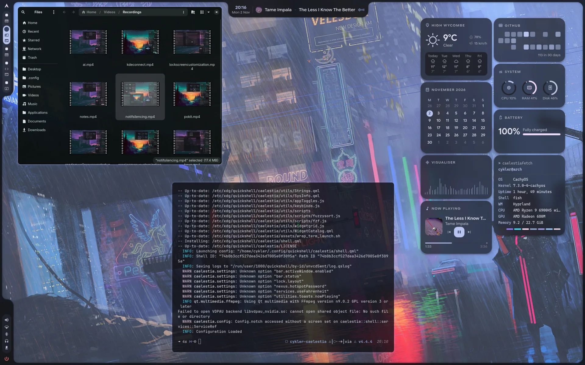
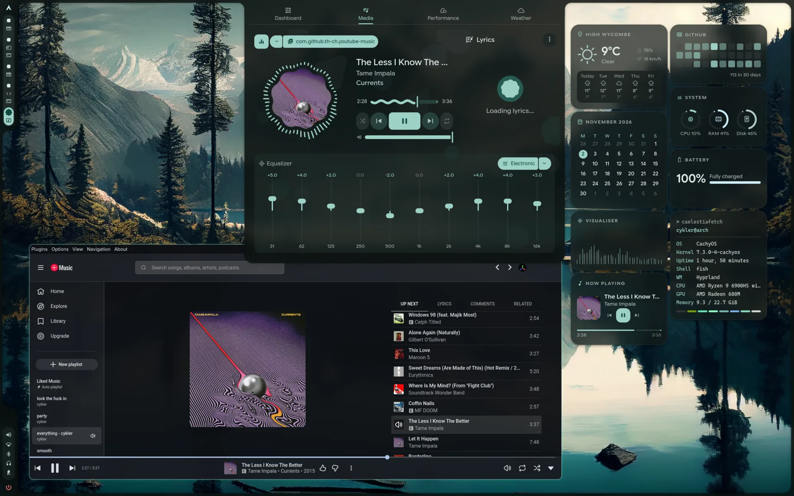
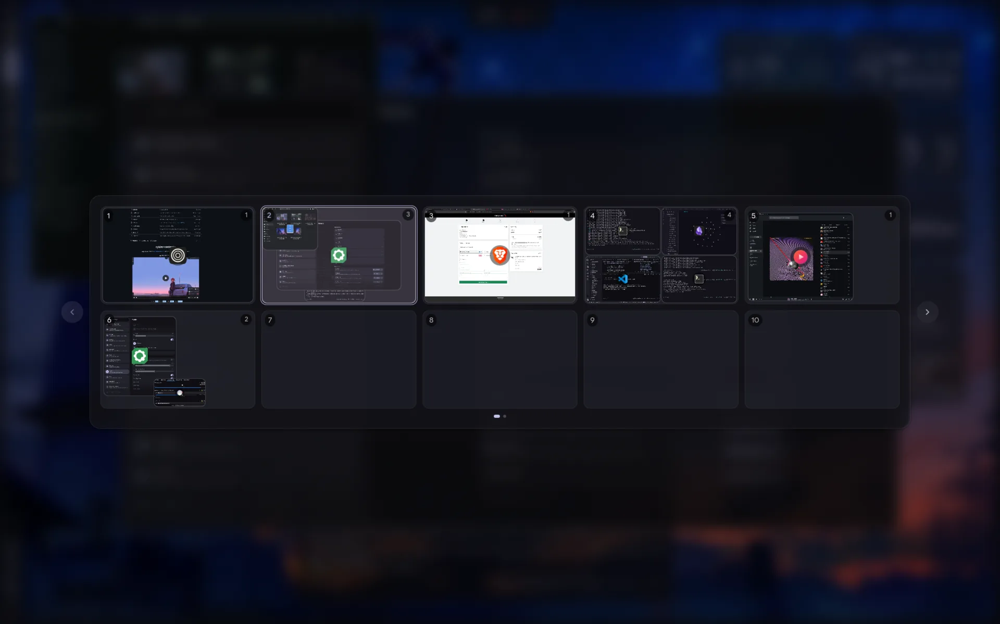
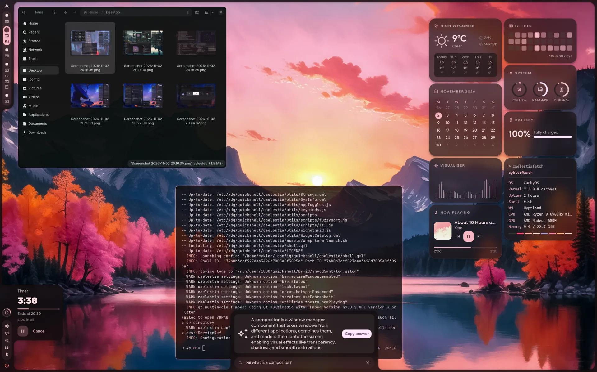
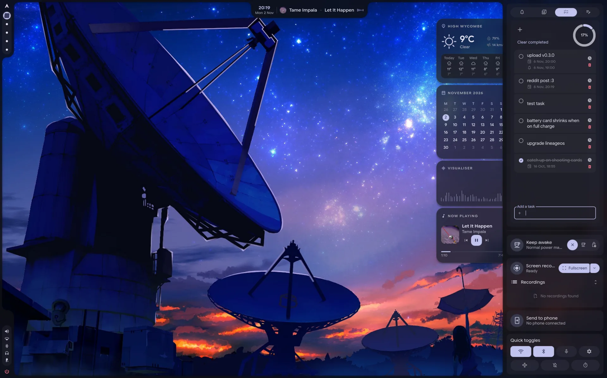
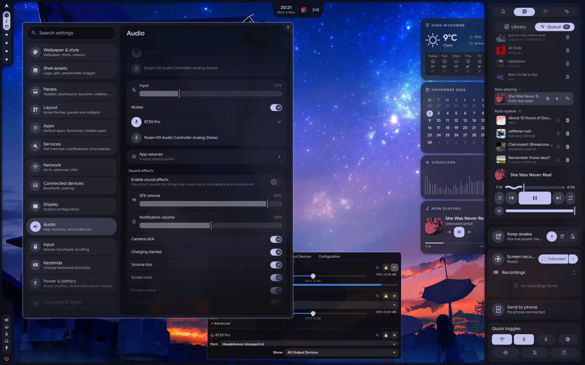
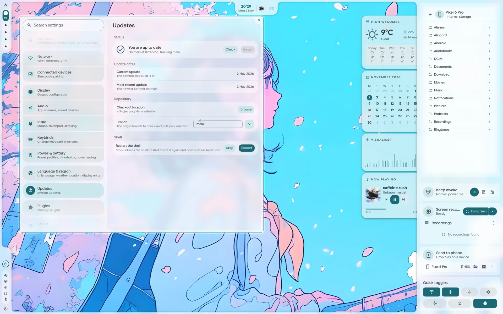
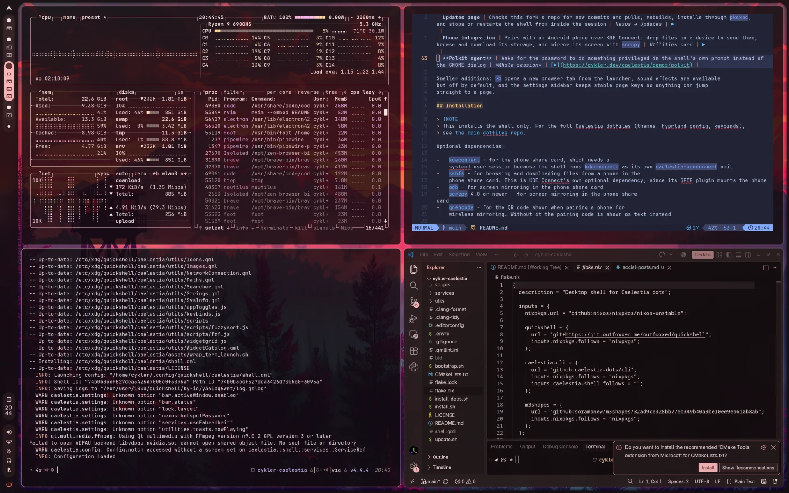

<h1 align=center>cykler-caelestia</h1>

<div align=center>

A personal fork of [caelestia-dots/shell](https://github.com/caelestia-dots/shell) with the features we wanted on top of it.

https://github.com/user-attachments/assets/83bc3015-1b8b-4b44-988c-f8a59c1dafeb

**[▶ Watch the full showcase](https://cykler.dev/projects/caelestia)**


</div>

> [!WARNING]
> **Optimised for our systems first.** The fork is built and tested around our own setups, but
> it should work on most other systems. If you run into an error, please open an
> [issue](https://github.com/cykler01/cykler-caelestia/issues).

<details open>
<summary><h2>Showcase</h2></summary>

<table>
  <tr>
    <td width="25%"><a href="docs/screenshots/desktop-widgets.webp"></a></td>
    <td width="25%"><a href="docs/screenshots/media-equalizer.webp"></a></td>
    <td width="25%"><a href="docs/screenshots/overview.webp"></a></td>
    <td width="25%"><a href="docs/screenshots/launcher-ai.webp"></a></td>
  </tr>
  <tr>
    <td width="25%"><a href="docs/screenshots/sidebar-todo.webp"></a></td>
    <td width="25%"><a href="docs/screenshots/settings-audio.webp"></a></td>
    <td width="25%"><a href="docs/screenshots/updates-phone.webp"></a></td>
    <td width="25%"><a href="docs/screenshots/dev-workspace.webp"></a></td>
  </tr>
</table>

</details>

<details>
<summary><h2>Features added in this fork</h2></summary>

Every feature below is either our own work on top of upstream, or upstream work this fork
has pulled in and built on.

| Feature | What it does | Where | Docs |
|---|---|---|---|
| **Lock screen customisation** | A fully custom layout, arranged in a full-screen editor like the desktop widgets: everything but the password field is an element to add, drag, resize, restyle, turn, restack or remove - clocks (one line, stacked, classic, analogue, words, flip cards, LED dots), dates and text, the profile picture, greeting, weather, status pills, info chips, now playing, a calendar, system info, widget columns, panels and dividers - with elements that show only until a key is pressed for a curtain that lifts, and 22 presets to start from, after the lock screens of macOS, Windows, Android, ChromeOS, KDE, LightDM, elementary OS, Nothing OS, smartwatches and more - with the login on either edge where it has one, picked from a preview of each, plus a lock screen wallpaper of its own, a blur strength, and status pills along the top edge chosen from battery, network, bluetooth, volume, mic, vpn, keyboard, notifications, media, power and uptime. Everything but the background fades away after a chosen idle delay, and the cards in the side columns are reordered, resized, added and removed, with the profile picture shape, analogue clock and revealed session controls all set here | *Nexus → Lock screen* | [▶](https://cykler.dev/caelestia/demos/lock-screen) |
| **Battery & power management** | Automatic Hyprland power saving (animations, blur, gaps, shadows, refresh rate) per plug state and power profile, battery level thresholds, critical battery shell shutdown, and a battery pane in Settings | *Nexus → Power & battery* | [▶](https://cykler.dev/caelestia/demos/battery) |
| **Keep awake** | One tri-state control for the idle inhibitor: off, prevent sleep, or also prevent lock | *Utilities card* | [▶](https://cykler.dev/caelestia/demos/idle) |
| **Countdown timer** | A utilities quick toggle with a bar ring and a details popout: set a duration, pause/resume, cancel and see when it ends | *Utilities → Timer* | [▶](https://cykler.dev/caelestia/demos/timer) |
| **Input settings** | Mouse sensitivity, scroll speed, touchpad scroll speed and acceleration, applied at runtime and put back after a Hyprland reload | *Nexus → Input* | [▶](https://cykler.dev/caelestia/demos/input) |
| **Local music player & library** | Plays `paths.musicDir` in-shell with a queue, shuffle and repeat, and browses the library by folder, artist, album or search | *Notif popout → Library* | [▶](https://cykler.dev/caelestia/demos/media-player) |
| **System-wide equalizer** | Opt-in ten-band PipeWire filter chain with presets, equalizing every stream rather than just the player | *Settings → Audio* | [▶](https://cykler.dev/caelestia/demos/equalizer) |
| **Play on several devices** | Send whatever is playing to more than one output at once - speakers and a headset, a desk and another room - with the output device itself unchanged, so per-app routing and volume go on working. Each extra device is a PipeWire loopback the shell owns, so nothing is left loaded if the shell goes away | *Settings → Audio*, or the speaker button in the bar's audio popout | — |
| **Notch** | A pill that drops down on track change with album art, controls and a mirrored spectrum, plus a standing notch that shows the clock, a running timer and what is playing while the bar's middle is free (the bar then drops its own clock). It doubles as a dynamic island: it drops down to say caps lock or num lock changed, shows notifications as they arrive instead of the corner popup, and asks for a password when something privileged needs one | *Nexus → Panels → Notch* | [▶](https://cykler.dev/caelestia/demos/notch) |
| **Notification dock improvements** | Chat apps keep every message instead of only the newest, and grouped notifications show each message's own picture | *Sidebar* | [▶](https://cykler.dev/caelestia/demos/notifications) |
| **Notification silencing** | Per-app allow/discard/silence rules, plus a do-not-disturb shortcut, so noisy apps can be muted without turning everything off | *Settings → Services → Notifications → Sources* | [▶](https://cykler.dev/caelestia/demos/notification-silencing) |
| **Popups and toasts in any corner** | Notification popups and toasts each go in any of the four corners, and share a column when they pick the same one | *Nexus → Layout* | [▶](https://cykler.dev/caelestia/demos/toast-corners) |
| **Window overview** | Every workspace and window in one blurred grid: click to jump, drag windows and whole workspaces, keyboard and page navigation | 4-finger swipe up / hot corner | [▶](https://cykler.dev/caelestia/demos/overview) |
| **Configurable hot corners** | Gives each of the four screen corners its own action: overview, sidebar, screenshot, OCR, Google Lens or colour picker | *Nexus → Panels → Hot corners* | [▶](https://cykler.dev/caelestia/demos/hot-corners) |
| **Special workspaces switch** | Turning special workspaces off makes the shell close them and move their windows to the current workspace, whatever opened them | *Settings → Workspaces* | [▶](https://cykler.dev/caelestia/demos/special-workspaces) |
| **Keybinds page** | Lists every `kb*` bind from the Hyprland Lua config, grouped and searchable, and writes your changes back and reloads | *Nexus → Keybinds* | [▶](https://cykler.dev/caelestia/demos/keybinds) |
| **OCR & Google Lens** | Select a screen region to copy the text in it with `tesseract`, or upload it and open it in Google Lens | Launcher `>ocr` / `>lens` | [▶](https://cykler.dev/caelestia/demos/launcher-ocr-lens) |
| **To-do list** | Multiple lists with deadlines and reminders, wrapping task text and inline editing, as the notification popout's third tab | *Notif popout → To-do* | [▶](https://cykler.dev/caelestia/demos/launcher-todo) |
| **Notepad** | Notes as plain files in a directory of your choosing (Documents by default): a browser to navigate it and an editor that autosaves as you type, as the notification popout's fourth tab | *Notif popout → Notepad* | [▶](https://cykler.dev/caelestia/demos/notepad) |
| **AI search and chat** | Opt-in `>ai ` launcher action that asks an AI service a question and copies the answer, and a chat tab in the sidebar and notification popout that keeps each conversation as a saved chat so an earlier one can be picked up again. Both share the one provider, key and model - Gemini, OpenAI, Anthropic, a local Ollama model or any OpenAI-compatible endpoint | Launcher `>ai ` / *Nexus → Launcher*, *Nexus → Sidebar* | [▶](https://cykler.dev/caelestia/demos/launcher-ai) |
| **Toggleable sidebar tabs** | Every sidebar tab except notifications can be switched off; notifications always stays as the first tab. Music, checklist and notes are on by default, AI chat is off | *Nexus → Sidebar* | [▶](https://cykler.dev/caelestia/demos/sidebar-tabs) |
| **SSH hosts** | Lists the non-wildcard hosts from `~/.ssh/config` and connects to one in your terminal | Launcher `>ssh` | [▶](https://cykler.dev/caelestia/demos/launcher-ssh) |
| **GPU modes** | Switches `supergfxctl` graphics modes and offers to restart or log out for them to take effect | Launcher `>gpu` | [▶](https://cykler.dev/caelestia/demos/launcher-gpu) |
| **Screenshot preview** | Screenshots go straight to the clipboard and show a framed thumbnail instead of a notification; click it to annotate, save to `~/Desktop`, or let it clear | After a capture | [▶](https://cykler.dev/caelestia/demos/screenshot) |
| **Shell assets page** | Changes the images the shell uses - logo, session and media gifs, placeholder images and the profile picture - from Settings, along with the lines shown at random along the bottom of the screen | *Nexus → Shell assets* | [▶](https://cykler.dev/caelestia/demos/shell-assets) |
| **Colour schemes in Settings** | Scheme, flavour and Material 3 variant pickers moved out of the launcher into the settings app | *Nexus → Wallpaper & style* | [▶](https://cykler.dev/caelestia/demos/settings-app) |
| **Wallpaper rotation** | Picks a random wallpaper at startup or cycles it on a timer | *Nexus → Wallpaper & style* | [▶](https://cykler.dev/caelestia/demos/wallpaper-cycling) |
| **Displays page** | Arranges monitors by drag and drop, sets resolution, refresh rate, scale and mirroring, identifies a display, and reverts by itself unless you confirm | *Nexus → Displays* | [▶](https://cykler.dev/caelestia/demos/displays) |
| **Dashboard performance graph** | CPU, GPU, memory, network and storage combined into a single card with configurable colours, and resources you switch off stay off | *Dashboard → Performance* | [▶](https://cykler.dev/caelestia/demos/dashboard) |
| **Layout editor** | A miniature screen where every part of the shell is a tile you drag into place - bar, launcher, dashboard, notch, sidebar, OSD, session menu, popups, toasts and the desktop items - with separate Shell and Desktop layers | *Nexus → Layout*  | [▶](https://cykler.dev/caelestia/demos/layout) |
| **Taskbar on any edge** | The bar moves to left, right, top or bottom with its own horizontal components, cuts its middle away on an empty workspace so the wallpaper shows through, and can mirror the right-edge panels when it is on the right | *Nexus → Layout*  | [▶](https://cykler.dev/caelestia/demos/bar) |
| **Session menu customisation** | Chooses which actions the session menu offers, and which the lock screen's session controls show, each as its own ordered on/off list | *Nexus → Panels → Session menu / Lock screen* | [▶](https://cykler.dev/caelestia/demos/session-menu) |
| **Desktop widgets & app shortcuts** | Widget cards (calendar, events, day progress, clock, weather, daylight, at a glance, focus timer, timers and alarms, resources, temperatures, network, now playing, lyrics, battery, Bluetooth battery, phone, Steam games, fetch, visualiser, colour scheme, web search, sticky note, pictures, GitHub, stocks, portfolio, progress, to-do, quick toggles and Claude limits), each picked from a grid of live previews and given one of its styles: an ordered grid you drag to rearrange, per-card on/off, live previews, card opacity and blur, and the settings the cards read (stocks tickers and holdings, progress milestones, the pictures folder, the GitHub name), plus application shortcuts | *Nexus → Panels → Desktop* | [▶](https://cykler.dev/caelestia/demos/desktop) |
| **Updates page** | Checks this fork's repo for new commits and pulls, rebuilds, installs through `pkexec`, and stops or restarts the shell from inside the session | *Nexus → Updates* | [▶](https://cykler.dev/caelestia/demos/updates) |
| **Phone integration** | Pairs with an Android phone over KDE Connect: drop files on a device to send them, browse and download its storage, and mirror its screen with `scrcpy` | *Utilities card* | [▶](https://cykler.dev/caelestia/demos/phone-integration) |
| **Polkit agent** | Asks for the password to do something privileged in the shell's own prompt instead of the GNOME dialog | *Whole session* | [▶](https://cykler.dev/caelestia/demos/polkit) |
| **Graphical installer** | Does the whole install from a window - what to build, which add-ons to include, and the theme to log into - asking exactly what `install.sh` would, and keeps going in the background if the window is closed | `./install.sh --gui` | — |
| **SDDM login theme** | A login screen in the shell's own colours, wearing whichever account's wallpaper and palette is picked, with the wi-fi it is on and the charge left in the battery, a power menu and optional fingerprint login | `./install.sh --with login-screen` | — |
| **Download progress** | A ring in the bar that fills as a browser or Steam download runs, with the file name, percentage and speed on hover and in the notch; a transfer that cannot say how large it will be gets a turning arc instead | Bar / notch | [▶](https://cykler.dev/caelestia/demos/download-progress) |
| **Workspace window previews** | Hovering a window's icon in the taskbar shows a live preview of that window and its title, so a workspace's windows can be told apart before switching to one | Taskbar workspace icons | [▶](https://cykler.dev/caelestia/demos/window-previews) |
| **Weather location picker** | Sets a fixed weather location by searching for a place or dropping a pin on the map, instead of leaving it to the IP lookup | *Nexus → Weather location* | [▶](https://cykler.dev/caelestia/demos/weather-location) |
| **Dashboard process list** | Every running process with its CPU and memory, sortable by either, and a way to end the selected one | *Dashboard → Performance* | [▶](https://cykler.dev/caelestia/demos/process-list) |
| **Rearrangeable dashboard** | The home page's four places (two rows, two columns) hold whichever cards you put in them, in your order, dragged around in a live preview; the old fixed layout is the default | *Nexus → Panels → Dashboard* | [▶](https://cykler.dev/caelestia/demos/dashboard-layout) |
| **Calendar events** | Reads GNOME Calendar through evolution-data-server, so local calendars, online accounts and the contacts' birthdays all come across, recurrences already expanded, only the calendars ticked in the app, each in the colour it has there, and a change in GNOME Calendar shows up without a refresh. Every event is sorted into regular (the routine, grey and kept off the lists), special one-offs (blue) or rare yearly ones (green), or a whole calendar given its kind. The dashboard's month grid marks the days with events and hovering a day lists them, a click opens GNOME Calendar, and the event and day progress cards sit on the desktop, the dashboard and the lock screen | *Nexus → Panels → Dashboard* | — |
| **Stopwatch & alarms** | Beside the countdown: a stopwatch with laps and alarms at a time of day, all still keeping time and ringing while the sidebar is shut, with the ring by the bar's clock and the notch's bubbles carrying on where the panel leaves off | *Utilities → Timer* | [▶](https://cykler.dev/caelestia/demos/timer) |

Smaller additions:

-   **Desktop text** - a line of text at random along the bottom of the screen, never the same one
    twice in a row, edited in *Nexus → Shell assets → Desktop text*: switch it on or off, choose the
    seconds between changes, add and remove lines, or bring the shell's own list back. Your lines are
    written to their own copy, so the shipped `assets/bottom-texts.txt` is left alone
-   **Window corner radius and window opacity** - how round the windows themselves are and how
    see-through, applied to open windows and written back to the Hyprland variables
    (*Nexus → Wallpaper & style*)
-   **Animation speed** - one multiplier over every animation the shell plays
-   **Scheduling priority** - the stock ananicy rulesets treat `qs` as a background service and give it
    nice 10, which costs wakeup latency and drops frames while scrolling, so it asks for nice -6 instead
    and renices the running shell without a restart (*Nexus → Plugins*)
-   **Floor and ceiling equalizer** - a large spectrum along the bottom edge or hanging from under the
    top bar, from the same cava capture as the other visualisers: bars, a filled wave or just the
    wave's outline, rounded pills or square blocks, its own bar count, and amplitude, smoothness and a
    loudness response (linear, logarithmic, square root or exponential) to shape it. In the theme
    colour, a gradient across the screen or a slowly turning rainbow, and faded out while nothing plays
    (*Nexus → Panels*)
-   **Settings search** - matches the individual toggles, sliders and pickers rather than only the
    page they are filed under, and shows which page and section each result came from
-   **Trackpad scrolling** - touchpad scroll speed and direction, applied at runtime and kept
    across a Hyprland reload (*Nexus → Input*)
-   **Bluetooth battery** - the charge left in each connected device, in the bar's Bluetooth popout
    and as a desktop widget
-   **Sidebar panel options** - full height, reveal on hover, and how tall the hover trigger is
    (*Nexus → Sidebar*)
-   **Dino game** - with nothing to read in it, the notification dock turns into the game on space
-   **Game mode** - one quick toggle that switches off Hyprland's animations, blur, gaps, shadows
    and mouse acceleration, and puts them all back
-   **Screen recording** - records the screen from the utilities card
-   **VPN toggle** - any command-driven VPN provider as a quick toggle
-   `>b` opens a new browser tab from the launcher
-   sound effects are available but off by default
-   the settings sidebar keeps stable page keys so anything can jump straight to a page

</details>

<details>
<summary><h2>Installation</h2></summary>

> [!NOTE]
> This installs the shell only. For the full Caelestia dotfiles (themes, Hyprland config, keybinds),
> see [the main dotfiles repo](https://github.com/caelestia-dots/caelestia).

Optional dependencies:

-   [`evolution-data-server`](https://gitlab.gnome.org/GNOME/evolution-data-server) and `python-gobject` -
    for the calendar events, which are read from the store GNOME Calendar keeps, so the dashboard and the
    event cards show the same calendars and events the app does
-   [`kdeconnect`](https://invent.kde.org/network/kdeconnect-kde) - for the phone share card, which needs a
    systemd user session because the shell runs `kdeconnectd` as its own `caelestia-kdeconnect` unit
-   [`sshfs`](https://github.com/libfuse/sshfs) - for browsing and downloading files from a phone in the
    phone share card. This is KDE Connect's own optional dependency, since its SFTP plugin mounts the phone
-   [`adb`](https://developer.android.com/tools/adb) - for screen mirroring in the phone share card
-   [`scrcpy`](https://github.com/Genymobile/scrcpy) 4.0 or newer - for screen mirroring in the phone share card
-   [`qrencode`](https://fukuchi.org/works/qrencode/) - for the QR code shown when pairing a phone for
    wireless mirroring. Without it the pairing code is shown as text instead

The phone share card is off by default - turn it on under **Cards** in *Nexus → Panels → Utilities*, which
loads KDE Connect and starts its daemon with it.

> [!IMPORTANT]
> If you previously installed `caelestia-shell` or `caelestia-shell-git` from the AUR, remove it
> first - this fork provides the same package and they conflict.

```sh
curl -fsSL https://raw.githubusercontent.com/cykler01/cykler-caelestia/main/bootstrap.sh | bash
```

That clones the repo into `./cykler-caelestia` and hands off to `install.sh`, which installs the
dependencies and then builds and installs the shell. Pass flags through after `--`, e.g. `curl -fsSL https://raw.githubusercontent.com/cykler01/cykler-caelestia/main/bootstrap.sh | bash -s -- -y`. Or do the same two steps by hand:

```sh
git clone https://github.com/cykler01/cykler-caelestia.git
cd cykler-caelestia
./install.sh
```

`install.sh` takes `--install-deps false` if you already have the dependencies, `--repo-only` to
skip AUR packages, or `-y` to skip the prompts. `--gui` asks all of the same questions in a window
instead, and `--with login-screen` also installs the SDDM theme (see `./install.sh --list-addons`
for what else is on offer). Then start it with `caelestia shell -d`.

Nix users can try the upstream flake that this fork keeps (although we haven't tested it ourselves):

```sh
nix run github:cykler01/cykler-caelestia#with-cli
```

### Keeping up to date

```sh
./update.sh
```

It pulls this fork and rebuilds and reinstalls, and refuses to run with uncommitted changes. Pass
`--upstream` to also merge `caelestia-dots/shell`, or `-y` to skip the prompts. We try to keep the
fork merged with upstream regularly (best effort, no promises).

Or do the same thing from inside the session: *Settings → Updates* checks the repo, shows what is
incoming, and can pull, rebuild, install and restart the shell for you.

</details>

## Credits

This fork is only worth anything because of the people below.

- **[Caelestia](https://github.com/caelestia-dots/shell)** - the shell itself, by
  [@soramanew](https://github.com/soramanew) and the upstream contributors. Everything here is their
  work with our additions on top.
- **[imnuclr](https://github.com/imnuclr)** - being the co-developer of this project and helping lots especially with the visuals and UI.
- **Battery power management** - based on [PR #1](https://github.com/cykler01/cykler-caelestia/pull/1) by [@PixelKhaos](https://github.com/PixelKhaos).
- **Displays page** - based on [PR #1629](https://github.com/caelestia-dots/shell/pull/1629) by
  [@devalentineomonya](https://github.com/devalentineomonya).
- **KDE-Connect card** - based on [PR #4](https://github.com/cykler01/cykler-caelestia/pull/4) by
  [@Mestane](https://github.com/Mestane).
- **workspace preview** and **proccess list** - based on [caelestia](https://github.com/luca-saggese/caelestia) by [@luca-saggese](https://github.com/luca-saggese)
- **Widgets Inspiration** - based on [lucid](https://github.com/Sn3akyy1/lucid) by [@Sn3akyy1](https://github.com/Sn3akyy1)

And special thanks again to [@Sn3akyy1](https://github.com/Sn3akyy1) for helping out with visual elements and offering feedback on the project.

## License

GPL-3.0, inherited from [upstream](https://github.com/caelestia-dots/shell).

## Star history

[](https://star-history.com/#cykler01/cykler-caelestia&Date)
